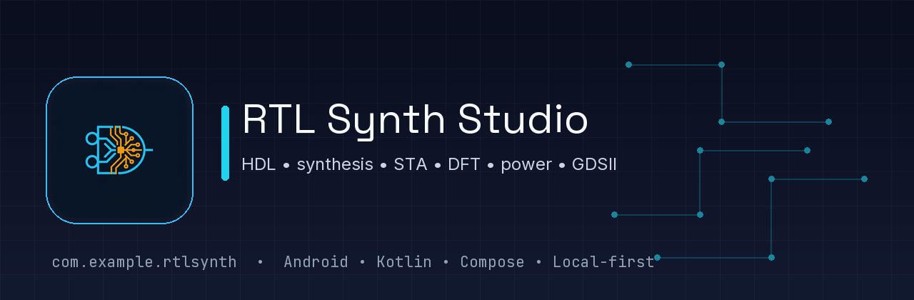

<div align="center">
  
</div>

<div align="center">
  <a href="https://github.com/a1vi/rtl-synth-studio/releases/latest/download/rtl-synth-studio.apk">
    
  </a>
  <a href="https://github.com/a1vi/rtl-synth-studio/actions/workflows/build-apk.yml">
    
  </a>
  <a href="https://github.com/a1vi/rtl-synth-studio/releases">
    
  </a>
  <br />
  
  
  
  
  
  
</div>

---

RTL Synth Studio is a local-first Android EDA workbench that takes multi-file RTL projects from HDL editing through synthesis, physical design, signoff analysis, and GDSII export — on-device.

## Highlights

- **Dashboard & projects** — overview metrics, project library, presets, run history, and local drafts.
- **Multi-file editor** — Verilog/SystemVerilog/VHDL/SDC/testbench files with syntax highlighting, tabs, import, and auto-save.
- **Synthesis** — multiple engine profiles, ASIC/FPGA target libraries, optimization goals, clock/SDC controls, and DFT scan insertion.
- **Schematic** — interactive gate-level netlist viewer with inspectors and schematic export.
- **Analysis suite** — timing (STA), area, power, simulation, GDS physical design, DFT, and formal equivalence.
- **STA & timing closure** — static timing analyzer, report parser, visual SDC editor, fix advisor, and violation remediation cards.
- **DFT / ATPG** — scan-chain stitching, ATPG pattern generation, coverage charts, and fault-analysis views.
- **Power & area** — power estimation engine, area distribution charts, and PPA reporting.
- **Formal verification** — logic equivalence checking (LEC) flows and UI.
- **RTL DRC** — design-rule checks and remediation components.
- **RTL-to-GDSII** — floorplan, placement, CTS, routing, DRC/LVS, binary GDSII, KLayout `.lyp`/PNG snapshot, and Tcl export.
- **PDK packages** — SHA-256 verified on-device standard-cell rule packages plus RAM/thermal guards.
- **Remote worker (optional)** — HTTP/JSON client for an external OpenLane/OpenROAD/Yosys workstation daemon.
- **Background flows** — foreground service keeps long synthesis/physical jobs alive with progress and cancel.
- **Reports & export** — engineering JSON, STA CSV, summaries, netlists, and shareable GDS bundles.
- **Local-first** — on-device JSON storage; no account required.

## App screens

| Tab | Purpose |
| --- | --- |
| Dashboard | Project/run overview and quick actions |
| Projects | Create/import RTL projects, presets, saved designs, run history |
| Editor | Multi-file HDL editor with syntax highlighting, tabs, import, auto-save |
| Synthesis | Engine/library/goal/clock/SDC selection and DFT options |
| Schematic | Interactive netlist schematic with inspectors/export |
| Analysis | STA, area, power, simulation, GDS, DFT, and formal-equivalence sub-tabs |
| Reports | Run reports, logs, waveforms, and export/share bundles |
| Settings | Theme, editor prefs, auto-save, defaults, optional remote bridge |

## Tech stack

| Layer | Technology |
| --- | --- |
| Language | Kotlin 2.2.10 |
| UI | Jetpack Compose (Material 3), Navigation |
| Architecture | MVVM, ViewModel, repository-style data layer |
| Storage | On-device JSON files in app-private storage |
| EDA | Custom Kotlin parsers, STA/DFT/ATPG/power/LEC engines, GDSII/KLayout flow |
| Optional | Remote workstation HTTP client, foreground service |
| Build | Gradle 9.3.1, Android Gradle Plugin 9.1.1 |
| Min/Target SDK | 24 / 36 |

## Download

Download the latest APK:

[](https://github.com/a1vi/rtl-synth-studio/releases/latest/download/rtl-synth-studio.apk)

Or open the [Releases page](https://github.com/a1vi/rtl-synth-studio/releases).

## Build from source

Prerequisites: JDK 17+, Android SDK platform 36, Gradle 9.3.1.

```bash
gradle assembleDebug
```

APK output: `app/build/outputs/apk/debug/app-debug.apk`.

GitHub Actions builds and publishes the APK automatically on pushes to `main` (see `.github/workflows/build-apk.yml`).

## Repository layout

```text
app/src/main/java/com/example/
├── data/          # models + on-device JSON workspace store
├── domain/synth/  # HDL parsers/AST, synthesis, STA, DFT/ATPG, power,
│                  # formal equivalence, DRC, RTL-to-GDS, GDSII/KLayout, PDK
├── service/       # foreground service for long EDA flows
└── ui/            # Compose screens (incl. analysis/*), components, theme, ViewModel
```

## Local storage & privacy

Projects, runs, drafts, settings, and generated PDK packages are stored locally on-device. The optional remote-worker setting only talks to an endpoint you configure.
